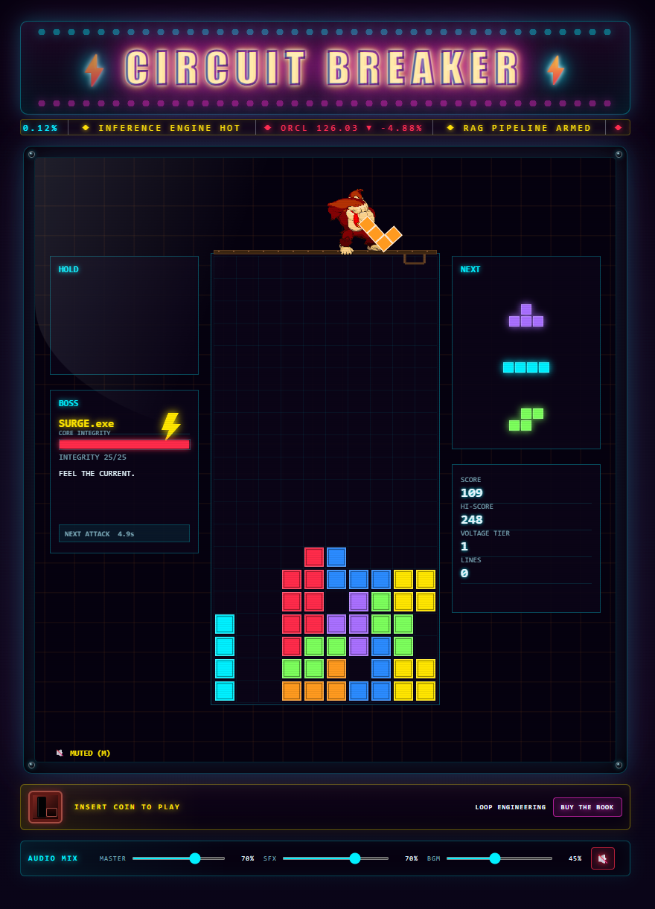

# ⚡ CIRCUIT BREAKER ⚡

> **HIGH VOLTAGE BLOCK STACKER** · **BOSS RUSH PROTOCOL** · **TRIP THE MAINFRAME**

<p align="center">
  
</p>

[](https://cb.correax.com)


*A high-voltage cyberpunk arcade **remix** — the falling blocks of Tetris,
the girder-perched gorilla hurling them down from a Donkey Kong-style
construction site, a **Boss Rush** mode where roaming Pac-Man-shaped
attackers chew through your stack, and an indicative AI-stock ticker
running across the marquee. Build the stack. Break the circuit.
Take down the mainframe.*

---

## ⚡ The concept

Three arcade DNA strands wired into one cabinet, with a fourth wire pulled
from somewhere far weirder:

- **Tetris** provides the core loop — a well, seven tetrominoes, gravity, and
  the pursuit of the line clear. Everything modern players expect is in the
  box: Super Rotation System, wall kicks, hold, ghost preview, a 7-bag
  randomiser, and hard drops.
- **Donkey Kong** supplies the *stage director*. A cartoon gorilla climbs an
  animated ladder onto the girder above the well at the start of every run,
  beats his chest, then paces back and forth **throwing each new piece down
  into the column he happens to be over**. Every run's column pressure is
  slightly different — the RNG has a face and a wind-up animation.
- **Pac-Man** shows up when you clear lines. Cleared rows summon glowing
  chomping Pacmen that streak across the well behind an RGB-split pellet
  trail; a Tetris (four-line clear) summons a giant *MAIN BREAKER* Pacman
  with foreground lightning. In Boss Rush, hostile Pacmen also appear as
  roaming attackers on the higher tiers.
- **A stock ticker** rides the cabinet marquee — indicative quotes
  for an AI-focused basket (`MSFT`, `NVDA`, `GOOGL`, `AMZN`, `META`, `AMD`,
  `AVGO`, `ORCL`, `PLTR`, `TSM`, `MU`, `ANET`, `VRT`), with
  *"Circuit Breaker AI Portfolio"* at the start of each complete cycle. It's the
  Bloomberg terminal that grew up watching *Tron*, and it gives the cabinet
  the exact mood of a trading floor about to trip a breaker.

The cabinet chrome, CRT scanlines, synthwave BGM, and animated marquee are
there to sell the illusion that you cracked open a rogue arcade machine at
2 a.m. and it's already running.

---

## ⚡ Play

Live in a browser near you: **[cb.correax.com](https://cb.correax.com)**

**Desktop browser and keyboard are the primary way to play.** Phone and touch
support are secondary; they should not compromise desktop controls or layout.

On iOS, Safari can add the site to the Home Screen using the dedicated lightning
icon. If an existing shortcut keeps its old icon, remove it and add it again.

Or run it locally with Node.js 22 or 24 (CI uses 22):

```bash
npm ci --registry=https://packagefeedproxy.microsoft.io/npm/
npm run dev # http://localhost:5173
```

The lockfile uses Microsoft's npm package proxy. The Vite development server also
serves `/api/quotes`, so local development can display the ticker's quote data.

Ship a static bundle:

```bash
npm run build # dist/
npm run preview
```

## 🎮 Controls

| Key           | Action                    |
| ------------- | ------------------------- |
| ← / →         | Move                      |
| ↓             | Soft drop                 |
| Space         | Hard drop                 |
| ↑ / X         | Rotate CW                 |
| Z             | Rotate CCW                |
| A             | Rotate 180°               |
| Shift / C     | Hold piece                |
| P / Esc       | Pause / resume            |
| M             | Mute audio                |
| R             | Retry the same seed       |

The start screen groups options into Play, Settings, and Controls tabs. Play
selects mode and difficulty. Settings contains the audio mixer, reduced effects,
and an expandable advanced section for the run seed and DAS/ARR timing.
Controls lists the keyboard reference. Start Game stays visible on every tab,
including on small screens where the content scrolls.

Fresh visits use these defaults:

| Setting | Default |
| --- | --- |
| Game mode | Boss Rush |
| Difficulty | Normal |
| Run seed | Random |
| Reduced effects | Off |
| Audio | Unmuted |
| Master / effects / music | 70% / 70% / 45% |
| DAS / ARR | 150 ms / 40 ms |

Audio mix, mute, reduced effects, and input timing persist in this browser.
Mode, difficulty, and seed are selected for each run rather than saved as defaults.
DAS (Delayed Auto Shift) is the delay before a held direction starts repeating.
ARR (Auto Repeat Rate) is the interval between repeated moves after that delay.
A tap moves one column immediately. Lower values make held movement more responsive.

Setup shortcuts: `1`/`2` select mode (Boss Rush / Free Stack), `3`/`4`/`5` select
difficulty (Chill / Normal / Overdrive), `[`/`]` tune DAS, and `;`/`'` tune ARR.
Enter or Space activates the focused button; arrow keys adjust sliders or
switch tabs when the tab bar has focus. Touch controls appear automatically on
touch-first devices.

Leave RUN SEED blank for a random run, or enter a whole number from `0` to
`4294967295`. The HUD shows your seed; `R` retries it with the same piece
sequence and random streams for boss attacks and Kong. Matching a full run
also requires the same inputs and timing.

Switching browser tabs or leaving the window pauses the game and releases held controls.
Resume explicitly with `P`, `Esc`, or the RESUME button. Pauses and boss cutscenes
do not count toward run time, and the final summary freezes when the run ends.

The pause screen's Settings button reopens the same settings and controls.
Audio, effects, and input timing remain adjustable; mode, difficulty, and seed
stay locked for the current run. Back to Pause or Esc returns to the pause screen
without resuming.

To change mode or difficulty, pause with `P` or `Esc` and choose Main Menu.
Your current run stays paused while you browse. Back to Game or `Esc` resumes
that run without applying mode, difficulty, or seed changes. Start New Game
replaces it using your selections.
Main Menu opens with your current mode, difficulty, and seed. Clear the seed
for a random run. Audio, effects, and input-timing changes still apply
immediately and remain saved.

The Reduced effects checkbox in Settings hides the stock ticker and disables
shake, flashes, foreground flourishes, and animated cabinet decorations. Attack
warnings, Kong's aim marker, and the ghost piece stay visible. Full effects are on
by default; your choice is saved for future visits.

Click or press any key to boot the cabinet. The browser requires a user gesture
before it can start the audio graph.

## 🕹️ Features

### Modern block-stacker fundamentals

Nothing that would surprise a competitive Tetris player. Rotation, kick tables,
and the randomiser all match modern conventions so muscle memory transfers
cleanly from Tetr.io / Jstris:

- Seven tetrominoes with full **SRS rotation + wall-kick tables** for JLSTZ and I
- **7-bag randomizer**, one-swap-per-drop hold, ghost preview, and next-three queue
- **T-spins** (3-corner rule; last action must be a rotation), **back-to-back ×1.5**
  on tetrises and T-spins, and **perfect-clear** bonuses
- **Lock delay capped at 15 resets** — no infinite stalling on the stack; the
  piece commits once the cap is hit
- **AMPERAGE ×N** combo tracker, **VOLTAGE TIER** that rises every ten line clears *and* on each boss defeat (whichever comes first) with a live *NEXT TIER IN N* progress bar under the LINES stat and gravity curve tied to tier
- Local best scores for each mode and difficulty, plus fastest Boss Rush wins
  for each difficulty. Your old shared high score stays visible as LEGACY BEST.
- Line clears freeze the row visibly-but-briefly while a neon Pacman streaks across the empty space, then the stack drops — the animation and the mutation happen together instead of the clear finishing before the effect starts

### Kong on the girder

Every run opens with Kong climbing a rusty I-beam ladder that animates down
from the top of the cabinet, retracts to a stub once he's on the girder, and
then he beats his chest before starting to pace. From that point on he owns
the spawn point:

- He paces the full board width with an organic wander (no ping-pong pattern)
- Every new piece plays a **wind-up → release** animation with the tetromino
  visibly arcing from his hand into the well
- Whichever column he's over when he throws is where the piece spawns — so
  drift matters, and you learn to read his facing direction
- He goes silent and still when you pause (**P**) so you can screenshot the
  throw mid-flight
- If his throw would collide with the stack, the piece **nudges to the nearest
  free column** instead of ending the run — only a genuinely full spawn zone
  tops you out
- A subtle aim marker shows the piece's intended columns during wind-up and
  release. AIM ADJUSTED marks a collision-driven change to the spawn point.
- When the run ends (top-out or victory) he breaks into a **five-pose
  360° victory spin** on the girder — front pose → side-profile spin →
  back pose → side → alt-front → side → alt-back → side, bouncing on each
  landing — because of course he does

### Boss Rush

Five rogue AIs stand between you and the mainframe. Each fight tracks
**BOSS INTEGRITY** on a dedicated HP bar; the BGM drops to a frantic
*boss-low* mix under 25% HP, and defeating one advances the **VOLTAGE TIER**
plus gravity curve:

1. **SURGE.exe** -- the warm-up, occasional voltage spikes
2. **BLACKOUT** -- hides your NEXT preview at random intervals
3. **SHORTFUSE** -- dumps garbage lines when you dawdle
4. **FEEDBACK LOOP** -- scrambles columns
5. **THE MAINFRAME** -- every attack, twice as fast

Every attack is **telegraphed a full second ahead**. Garbage previews its exact
hole positions, and scramble warnings mark the two columns that will swap.
Clear lines during a garbage warning to cancel one incoming row per line,
starting with the earliest row. A scramble waits if it would overlap your
falling piece, then executes once the piece clears its path. Boss HP is paced per
tier (18 / 25 / 35 / 45 / 70) with +10% damage per voltage tier, and intro
cutscenes are skippable.

A red **danger vignette** pulses while the stack rides within five rows of the
top, and every run ends with a **telemetry summary** — time, pieces, lines per
minute, max combo, T-spins, bosses down.

### Audio (100% procedural, no assets)

The soundtrack is generated at runtime from a Web Audio graph — no MP3s, no
sample libraries. That keeps the download tiny and every session slightly
different:

- Web Audio graph with reverb send/return bus + master DynamicsCompressor
- Synthwave sequencer: chord progressions, detuned-saw lead, ambient pad, real drum kit
- Punchy layered SFX: hard-drop sub boom, chromatic line-clear zaps, tetris BOOM with fanfare stab
- Persisted master, SFX, and BGM mixer controls plus `M` mute shortcut

### The look

Gameplay effects use Canvas 2D; the cabinet, ticker, and setup dialog use HTML and
CSS. Kong uses the credited PNG sprite sheets:

- Circuit-trace animated background, CRT scanlines, screen shake, chromatic flash
- **Neon Pacman line clear** -- one chomping cyberpunk Pacman per cleared row, alternating direction, RGB split, and glowing pellet trail; a Tetris summons a giant breaker Pacman with foreground lightning arcs
- `MAIN BREAKER TRIPPED` four-line-clear banner, circuit lightning, particles, screen shake, and chromatic flash
- The Grid Wraith appears over the board for four seconds when a run ends,
  hovering and fading out.
- Each ticker cycle starts with "Circuit Breaker AI Portfolio", followed by the full AI-focused stock list
- The start screen's Play tab includes the `INSERT COIN` / `BUY THE BOOK` link to
  *Loop Engineering* on Amazon. It is absent during gameplay and paused settings.
- Responsive arcade cabinet chrome with animated marquee, occasional blinking lights, scrolling ticker, bezel reflection, and corner screws
- Hot-path glows (particles, pellet trails, active-piece halos) stamp
  pre-baked radial sprites instead of per-frame `shadowBlur`, and the marquee
  ticker scrolls at a constant speed on its own compositor layer, reducing
  per-frame paint work

### Ticker and privacy

The market ticker at the top of the cabinet is real data with no tracking
attached — the client only ever talks to our own first-party endpoint, and
that endpoint is aggressively cached:

- The browser calls only the first-party `/api/quotes` endpoint; it never contacts the quote provider directly.
- The configured stock basket is defined in [`api/src/quotes.js`](api/src/quotes.js).
  The server uses a five-minute cache, a short browser/edge cache, and bounded retries.
- Percentage changes compare the regular-market price with the previous regular-session close, not a multi-day chart baseline or extended-hours price.
- The browser fetches quotes once per page load; the ticker is not a streaming
  feed and does not refresh automatically. Reload the page to request updated data.
- If quote retrieval fails, the ticker shows only the portfolio name and gameplay remains unaffected.
- Ticker values and interaction are not tracked. The Amazon purchase link is not tracked either.
- Production sends only the approved homepage `page_view` event. Game state,
  scores, settings, and inputs stay local; see [INSTRUMENTATION.md](INSTRUMENTATION.md).

## 🛠️ Tech

Built with an unfashionably small stack for a game that leans this hard on
visual and audio effects:

- **TypeScript** (strict) + **HTML5 Canvas 2D** + **Web Audio API**
- **Vite** for dev / build
- **Zero client runtime package dependencies**; the quote API uses `@azure/functions`
- Deployed on **Azure Static Web Apps** at the custom domain `cb.correax.com`

The game renders before audio is unlocked. A user gesture starts the audio graph.

## 📂 Project layout

```text
src/
├── main.ts           # boot, game loop, wiring
├── game.ts           # phase machine, scoring, boss orchestration
├── board.ts          # grid + line-clear
├── piece.ts          # tetromino shapes, SRS wall-kicks, 7-bag
├── kong.ts           # Kong actor: state machine + sprite rendering
├── bosses.ts         # boss definitions and attack patterns
├── effects.ts        # particles, lightning, announcements, Pacman runs
├── renderer.ts       # canvas draw pipeline
├── input.ts          # keyboard + DAS/ARR
├── setup-panel.ts    # shared startup/paused dialog and accessible tabs
├── frame-timing.ts   # elapsed-time bounds for gameplay and input
├── random.ts         # seeded gameplay streams, independent of cosmetic randomness
├── storage.ts        # ruleset records, legacy score, audio, input, and effects preferences
├── market-ticker.ts  # portfolio name and indicative quote ticker
├── audio/
│   ├── audio.ts      # graph, mixer persistence, reverb bus, compressor
│   ├── music.ts      # synthwave sequencer
│   └── sfx.ts        # procedural SFX bank
└── ...

api/
├── src/quotes.js      # cached, bounded-concurrency indicative quote adapter
└── src/functions/     # Azure Functions v4 quote endpoint

public/
├── kong-sprite.png            # Kong sprite sheet (see CREDITS.md)
├── kong-dance.png             # Kong celebration dance strip (see CREDITS.md)
├── circuit-breaker-social.png # OpenGraph / social preview
├── apple-touch-icon.png       # opaque 180x180 iOS Home Screen icon
├── client/                   # production visit-tracker scripts
└── staticwebapp.config.json   # security headers, caching, and Azure routes

docs/
└── assets/
    ├── banner.png
    ├── gameplay.png           # README hero screenshot
    └── sources/               # reference art kept for provenance
```

## 🚀 Deploy

The normal release path is a commit pushed directly to `main`; pull requests are
not required for this solo project. A push runs typecheck, tests,
production build, artifact validation, and deployment through
the [Azure Static Web Apps workflow](.github/workflows/azure-static-web-apps.yml).
The workflow deploys both `dist/` and the quote API in `api/`.

The workflow also supports tracker-disabled previews if a pull request is used.
Production pushes set `CB_TRACKER_ENABLED=true`; ordinary local builds omit tracking.

Run the complete local gate before a release:

```bash
npm run check
```

Check the production activation separately, setting the flag before building:

```powershell
$env:CB_TRACKER_ENABLED = 'true'
npm run build
npm run validate -- --tracking-enabled
Remove-Item Env:CB_TRACKER_ENABLED
```

Do not deploy `dist/` alone as a substitute for the workflow: it omits the quote
API. After deployment, confirm the homepage, scripts, icon, and `/api/quotes`
responses at the canonical URL. Tracker-specific checks are in
[INSTRUMENTATION.md](INSTRUMENTATION.md).

## Project documentation

| Document | Purpose |
| --- | --- |
| [PLAN.md](PLAN.md) | Current delivery record and architecture decisions |
| [HANDOFF.md](HANDOFF.md) | Restart state, open work, and the next action |
| [INSTRUMENTATION.md](INSTRUMENTATION.md) | Tracking boundaries, quote-data behavior, and production verification |
| [CREDITS.md](CREDITS.md) | Third-party artwork provenance and licensing limits |
| [public/llms.txt](public/llms.txt) | Concise published facts for automated consumers |

## 📜 License

The code has been described as MIT, but this repository does not currently track a
standalone `LICENSE` file.

Third-party art is not covered by that statement. The Kong sprite sheet and
celebration dance strip have separate attribution and permission limits in
[CREDITS.md](CREDITS.md). Preserve those attributions if you fork the game.
